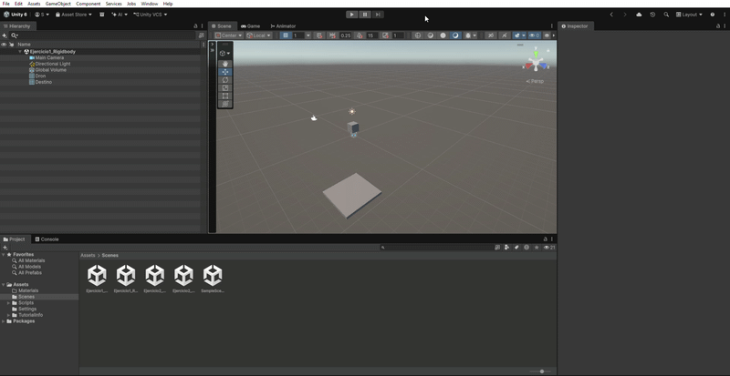
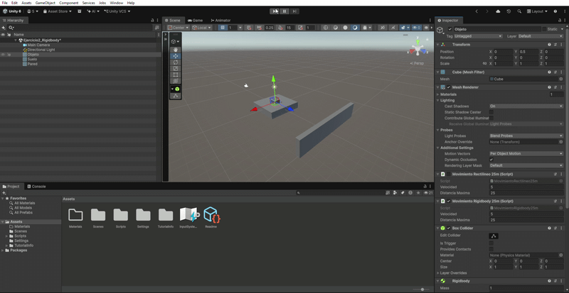

# Prueba de Movimiento Rectilíneo - 3D

## Descripción

En esta práctica se trabaja el movimiento rectilíneo de objetos en Unity 3D, utilizando tanto `Transform` como `Rigidbody`.

Se estudian conceptos como la dirección del movimiento, la velocidad, la distancia recorrida, las colisiones, la gravedad y las diferencias entre el movimiento mediante Transform y el sistema de físicas de Unity.

---

# Ejercicio 1. Movimiento hacia un destino

En este ejercicio se programa un objeto para que se desplace hacia un destino indicado desde el Inspector, a una velocidad de 4 m/s.

### Apartados trabajados

- Movimiento hacia un objetivo.
- Cálculo de dirección mediante vectores.
- Uso de `Vector3.normalized`.
- Uso de `Time.deltaTime` para mantener una velocidad constante.
- Control de la distancia restante para evitar sobrepasar el destino.
- Movimiento mediante `Transform` y `Rigidbody`.
- Detección de llegada mediante `OnTriggerEnter()`.

### Demostración

### Ejercicio 1. Movimiento hacia un destino

---

# Ejercicio 2. Movimiento rectilíneo de 25 metros

En este ejercicio se programa un objeto para que avance en línea recta a una velocidad de 5 m/s, recorriendo un máximo de 25 metros.

### Apartados trabajados

- Movimiento rectilíneo.
- Cálculo de la distancia recorrida.
- Almacenamiento de la posición inicial.
- Uso de `transform.forward` para determinar la dirección.
- Control de la distancia máxima.
- Movimiento mediante `Transform` y `Rigidbody`.
- Detección de colisiones con una pared.
- Uso de `Debug.Log()` para mostrar mensajes en la consola.

### Demostración

### Ejercicio 2. Movimiento rectilíneo

---

# Conceptos aprendidos

- Vectores y direcciones.
- Normalización de vectores.
- `Time.deltaTime`.
- `Transform`.
- `Rigidbody`.
- `MovePosition`.
- `OnTriggerEnter()`.
- `OnCollisionEnter()`.
- Colliders y Triggers.
- Gravedad y colisiones físicas.
- Diferencias entre movimiento por Transform y físicas.

---

# Herramientas utilizadas

- Unity.
- C#.
- Git.
- GitHub.